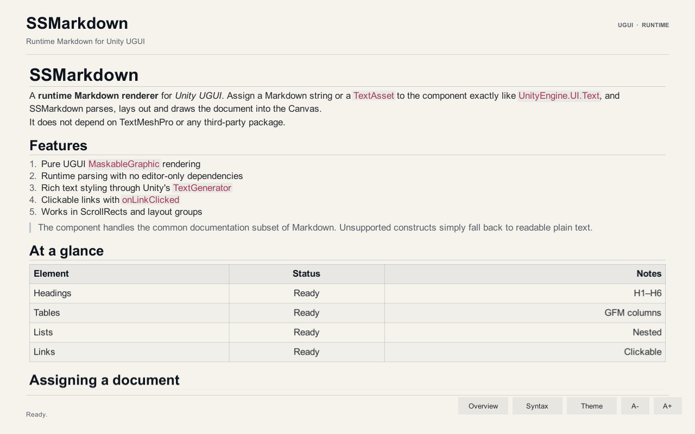
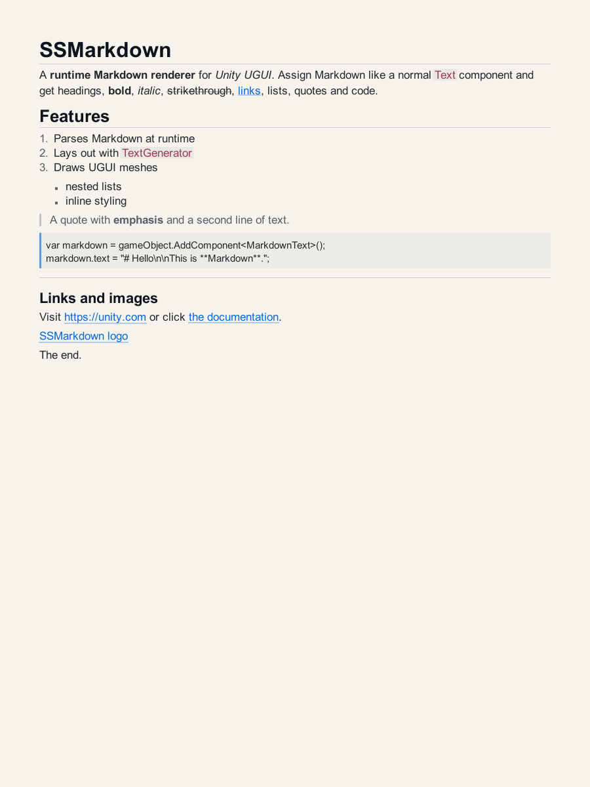
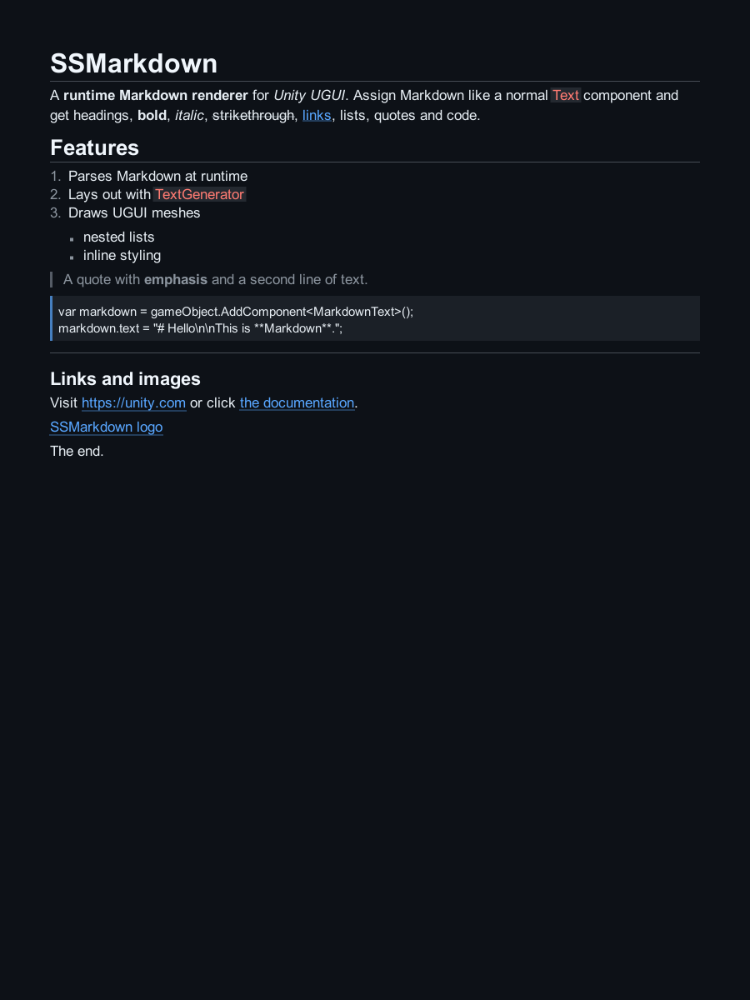

# SSMarkdown

**基于 Unity UGUI 的运行时 Markdown 渲染组件。** 像使用 `UnityEngine.UI.Text` 一样赋值，即可在 Canvas 中显示标题、段落、强调、链接、列表、引用和代码块。

本仓库同时是一个可通过 **Unity Package Manager（UPM）** 导入的包，以及一个完全独立的演示工程。



## 包信息

| 项目 | 值 |
| --- | --- |
| Package name | `com.ssmarkdown` |
| 运行时命名空间 | `SS.UIComponent` |
| 组件 | `MarkdownText : MaskableGraphic` |
| 最低 Unity 版本 | 2022.3 LTS |
| UGUI | `com.unity.ugui` 1.0.0 |
| 许可证 | MIT |

## 通过 UPM 安装

### 方式一：Git URL（推荐）

在 Unity 中打开：

**Window > Package Manager > + > Add package from git URL...**

输入：

```text
https://github.com/SlipperSoar/SSMarkdown.git#v1.0.0
```

也可以直接写入项目的 `Packages/manifest.json`：

```json
{
  "dependencies": {
    "com.ssmarkdown": "https://github.com/SlipperSoar/SSMarkdown.git#v1.0.0"
  }
}
```

把 `v1.0.0` 换成 `main` 可跟踪主分支最新提交。

> 仓库是 **Private** 的。Unity 通过系统 Git 拉取 Git URL，请先配置 GitHub 凭据（Git Credential Manager 或 SSH key）。如果当前机器没有可用凭据，使用下面的本地安装方式。

### 方式二：本地克隆后安装

```powershell
git clone https://github.com/SlipperSoar/SSMarkdown.git
```

然后在 Package Manager 中点击 **+ > Add package from disk...**，选择仓库根目录的 `package.json`。或在目标项目的 `Packages/manifest.json` 中写相对路径：

```json
{
  "dependencies": {
    "com.ssmarkdown": "file:../../SSMarkdown"
  }
}
```

`file:` 路径相对于目标工程的 `Packages` 目录（不是工程根目录），请按实际克隆位置调整；如果包直接放在工程的 `Packages/com.ssmarkdown` 下，则写 `file:com.ssmarkdown`。

### 安装后验证

包安装成功后，Package Manager 的 **In Project** 中会出现 **SSMarkdown**，并且可以这样引用：

```csharp
using SS.UIComponent;
using UnityEngine;

public sealed class ReadmePanel : MonoBehaviour
{
    [SerializeField] private MarkdownText m_View;

    private void Start()
    {
        m_View.text = "# Hello\n\nThis is **Markdown** with a [link](https://example.com).";
        m_View.onLinkClicked.AddListener(url => Debug.Log("Clicked: " + url));
    }
}
```

也可以在编辑器中点击 **GameObject > UI > Markdown Text** 创建组件。

## 独立演示工程

演示部分已从包中移出，位于：

```text
Demo~/
```

`Demo~` 是一个完整的 Unity 工程，使用 `file:../..` 引用仓库根目录的 UPM 包，不参与包导入。

打开方式：

1. Unity Hub 选择 **Add project from disk**。
2. 选择仓库下的 `Demo~` 目录（目录名末尾的 `~` 是 UPM 排除标记，在文件系统中仍是普通目录）。
3. 使用 Unity 2022.3 打开。
4. 打开场景 `Assets/SSMarkdownDemo/Scenes/MarkdownDemo.unity`。
5. 运行后可以切换 Overview / Syntax、Light / Dark、字号，并点击链接查看 `onLinkClicked`。

包本身不包含演示场景，因此导入到其他项目时不会引入 Demo 的脚本或资源。

## 待办事项

- [x] GFM 表格解析与列宽排版
- [ ] 引用式链接（reference-style links）与脚注
- [ ] 任务列表 `- [ ]` / `- [x]` 的复选框绘制
- [ ] 图片渲染：内置 Sprite 引用与异步 URL 图片加载
- [ ] 代码块语言标签与可选的语法高亮接口
- [ ] 文本选择与复制
- [ ] 链接 hover 光标、hover 高亮和键盘导航
- [ ] 中日韩字体的自动回退与更精确的断行规则
- [ ] PlayMode 测试、布局性能基准和大量文档的虚拟化
- [ ] 基于 Unity License 的 CI 导入/编译/测试流水线

欢迎通过 Issue 或 PR 补充优先级。

## 特性

- **纯 UGUI 实现**：组件 `MarkdownText` 继承 `MaskableGraphic`，自带 `ILayoutElement`、点击命中和 Maskable 支持，不依赖 TextMeshPro 或第三方库。
- **运行时赋值**：`text` 属性、`SetMarkdown(string)`、`SetMarkdown(TextAsset)` 三种方式。
- **文档级排版**：按块级元素独立排版，支持标题层级、段落间距、嵌套列表、引用缩进、代码块背景、表格和分隔线。
- **内联样式**：加粗、斜体、删除线、行内代码、链接、自动链接、HTML 实体和反斜杠转义。
- **可点击链接**：`onLinkClicked` 事件返回 URL，支持 `TryGetLinkAtLocalPosition` 做自定义悬浮提示。
- **主题**：内置 Light / Dark 两套配色，切换主题时正文、标题、引用与底板一起更新。
- **ScrollRect / LayoutGroup 友好**：实现 `ILayoutElement`，搭配 `ContentSizeFitter` 自动撑高；装饰层会跟随滚动内容。
- **纯 C# 解析器**：解析器不依赖 UnityEngine，可单独在 .NET 中测试。
- **编辑器工具**：`GameObject/UI/Markdown Text` 菜单、自定义 Inspector。

## 组件 API

| 成员 | 说明 |
| --- | --- |
| `string text` | Markdown 源文本，赋值后自动重新解析和排版。 |
| `SetMarkdown(string)` | `text` 的语义化别名。 |
| `SetMarkdown(TextAsset)` | 直接赋值 `.md` 文本资源。 |
| `Font font` | 字体；为空时回退到 `LegacyRuntime.ttf` / `Arial.ttf`。 |
| `int fontSize` | 正文字号，标题按主题缩放。 |
| `TextAnchor alignment` | 水平对齐 + 整篇文档的垂直对齐。 |
| `Vector4 padding` | 左、上、右、下内边距。 |
| `MarkdownTheme theme` | 颜色、背景、间距、标题比例等。 |
| `bool enableLinks` | 是否启用链接命中与事件。 |
| `MarkdownLinkEvent onLinkClicked` | 链接点击事件，参数为 URL。 |
| `MarkdownDocument document` | 当前解析结果，可读取 blocks。 |
| `float contentHeight` | 当前宽度下的文档高度。 |
| `void ApplyTheme(MarkdownTheme)` | 应用主题，并同步 `theme.bodyColor` 到 `color`。 |
| `UseLightTheme()` / `UseDarkTheme()` | 应用内置主题。 |
| `void Refresh()` | 强制重新解析和排版。 |
| `bool TryGetLinkAtLocalPosition(...)` | 本地坐标链接命中，便于实现悬浮效果。 |

`MarkdownText.color` 仍然是正文和列表颜色的最终来源。`ApplyTheme()` / `UseLightTheme()` / `UseDarkTheme()` 会应用 `MarkdownTheme.bodyColor`；如果只手动修改主题里的单个字段，需要自行同步 `color` 并调用 `Refresh()`。

## 主题与对比度

`MarkdownTheme` 提供 `CreateLight()`、`CreateDark()`、`CopyFrom()`。

Dark 主题内置不透明深色 `backgroundColor` 和浅色 `bodyColor`，因此即使 `MarkdownText` 的父级背景仍是浅色，切换后标题、正文、列表和引用也都有足够对比度。将 `theme.backgroundColor` 的 alpha 调为 `0` 可以恢复透明底板；Light 主题默认透明。

演示工程会额外切换整页背景；包组件只负责自己的文档矩形。

## 布局建议

### 自适应高度

给 `MarkdownText` 所在 GameObject 添加 `ContentSizeFitter`：

- Horizontal Fit: `Unconstrained`
- Vertical Fit: `PreferredSize`

宽度应由父级布局或 RectTransform 锚点决定。`MarkdownText` 的 `preferredWidth` 为 `0`、`flexibleWidth` 为 `1`，这是为了让文档优先占满可用宽度，而不是按最长一行无限撑宽。

### 放在 ScrollRect 中

```text
Scroll View (ScrollRect)
└─ Viewport (RectMask2D)
   └─ Markdown Content (MarkdownText + ContentSizeFitter)
```

组件会在同一个父节点下自动创建一个隐藏的装饰层，用于绘制底板、代码块背景、引用条、链接下划线和分隔线。该层会同步 RectTransform 并跟随滚动。

### 中文字体

Unity 内置的 `LegacyRuntime` 字体不包含中日韩字形。显示中文时，请导入一个覆盖所需字符的 TTF/OTF 并赋给 `font`。

## Markdown 支持范围

**块级**

- `#` 到 `######` ATX 标题，以及 `===` / `---` Setext 标题
- 段落、硬换行（行尾两个空格或 `\`）
- 围栏代码块（``` 或 ~~~，保留原始文本）
- 四空格缩进代码块
- 引用，可嵌套
- 有序 / 无序列表，可嵌套
- GFM 表格，支持左 / 中 / 右列对齐、单元格内联样式和链接
- 分隔线

**行内**

- `**bold**` / `__bold__`
- `*italic*` / `_italic_`
- `~~strikethrough~~`
- `` `inline code` ``
- `[text](url "title")`
- `<https://...>` 自动链接
- 裸 URL 自动链接
- `&amp;`、`&lt;`、`&#x...;` 等常见实体
- 反斜杠转义

**有意不支持（见待办）**

- 脚注、引用式链接、任务列表
- 语法高亮
- 图片像素级绘制（`` 会显示 alt 文本并保留链接目标）
- 原始 HTML 样式（标签会被忽略，不参与渲染）

解析器对未知结构采取“退化为普通文本”的策略，不会在运行时抛异常。

## 仓库结构

```text
.
├─ package.json                 # UPM package manifest
├─ Runtime/                     # 运行时程序集 SSMarkdown.Runtime
│  └─ Markdown/
├─ Editor/                      # 编辑器程序集 SSMarkdown.Editor
├─ Tests/                       # Unity EditMode 测试（testables）
├─ Demo~/                       # 独立 Unity 演示工程，不参与包导入
│  ├─ Assets/SSMarkdownDemo/
│  ├─ Packages/manifest.json    # com.ssmarkdown: file:../..
│  └─ ProjectSettings/
├─ Tools~/ParserTests/          # 无 Unity 依赖的解析器测试
├─ Documentation~/              # 截图
├─ README.md
├─ CHANGELOG.md
└─ LICENSE.md
```

渲染分为两层：

1. **文本层**：`MarkdownText` 使用 `TextGenerator` 生成字形网格，设置 `pivot = (0, 1)` 后逐块堆叠。
2. **装饰层**：独立 `MaskableGraphic` 使用白色纹理绘制实心矩形；通过字体图集之外的第二张纹理解决 UGUI Graphic 单纹理限制。

`TextGenerator` 的 `characters` 数组按源字符串索引（包含富文本标签）返回每个字符，因此字符到 `MarkdownInline` 的映射可以准确跨越颜色、粗体、斜体标签。

## 测试

纯 C# 解析器测试：

```powershell
dotnet run --project Tools~/ParserTests/ParserTests.csproj -c Release
```

Unity EditMode 测试通过 `Demo~` 工程运行（manifest 中已配置 `"testables": ["com.ssmarkdown"]`）：

1. 用 Unity 打开 `Demo~`。
2. **Window > General > Test Runner > EditMode > Run All**。

命令行方式：

```powershell
& "C:\Program Files\Unity\Hub\Editor\2022.3.62f3c1\Editor\Unity.exe" `
  -batchmode -nographics -projectPath ".\Demo~" `
  -runTests -testPlatform EditMode `
  -testResults TestResults.xml
```

当前测试覆盖解析、样式、列表、引用、代码块尖括号、表格、链接命中、主题切换和空文档高度。

## 截图

| Light | Dark |
| --- | --- |
|  |  |

## 版本

见 [CHANGELOG.md](CHANGELOG.md)。

## License

[MIT](LICENSE.md)
