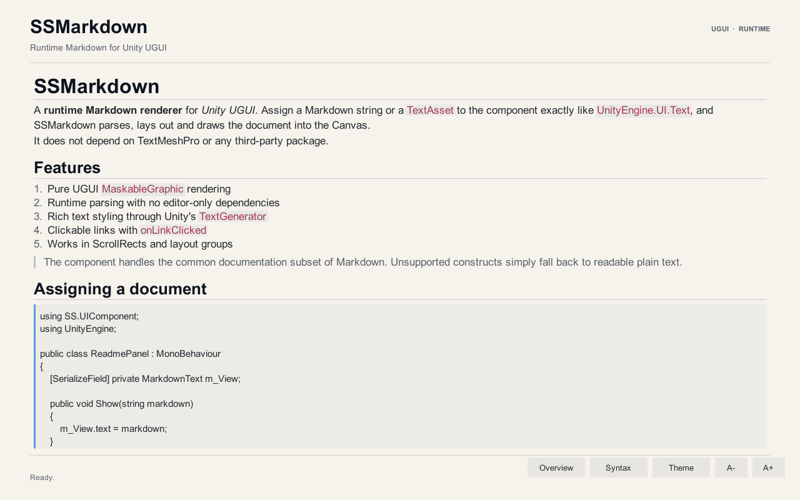

# SSMarkdown

**基于 Unity UGUI 的运行时 Markdown 渲染组件。** 像使用 `UnityEngine.UI.Text` 一样赋值，即可在 Canvas 中显示 headings、段落、强调、链接、列表、引用和代码块。



## 特性

- **纯 UGUI 实现**：组件 `MarkdownText` 继承 `MaskableGraphic`，自带 `ILayoutElement`、点击命中和 Maskable 支持，不依赖 TextMeshPro 或第三方库。
- **运行时赋值**：`text` 属性、`SetMarkdown(string)`、`SetMarkdown(TextAsset)` 三种方式。
- **文档级排版**：按块级元素独立排版，支持标题层级、段落间距、嵌套列表、引用缩进、代码块背景和分隔线。
- **内联样式**：加粗、斜体、删除线、行内代码、链接、自动链接、HTML 实体和反斜杠转义。
- **可点击链接**：`onLinkClicked` 事件返回 URL，支持 `TryGetLinkAtLocalPosition` 做自定义悬浮提示。
- **主题**：内置 Light / Dark 两套配色，可复制、修改 `MarkdownTheme`；Dark 主题内置深色底板，避免浅色父级下白字看不清。
- **ScrollRect / LayoutGroup 友好**：实现 `ILayoutElement`，搭配 `ContentSizeFitter` 自动撑高；装饰层会跟随滚动内容。
- **纯 C# 解析器**：解析器不依赖 UnityEngine，可单独在 .NET 中测试。
- **编辑器工具**：`GameObject/UI/Markdown Text` 菜单、自定义 Inspector、一键重建演示场景。

## 环境

- Unity **2022.3 LTS**（仓库使用 `2022.3.62f3c1` 验证）
- Unity UI (`com.unity.ugui`) 1.0.0
- Unity Test Framework 1.1.33（仅测试需要）

## 快速开始

1. 用 Unity Hub 打开本仓库根目录。
2. 打开演示场景：`Assets/SSMarkdown/Demo/Scenes/MarkdownDemo.unity`。
3. 或在编辑器中点击 **GameObject > UI > Markdown Text** 创建组件。
4. 在 Inspector 的 **Markdown** 文本框中输入内容，或按下面的方式在代码中赋值。

```csharp
using SS.UIComponent;
using UnityEngine;

public sealed class ReadmePanel : MonoBehaviour
{
    [SerializeField] private MarkdownText m_View;

    private void Start()
    {
        m_View.text = "# Hello\n\nThis is **Markdown** with a [link](https://example.com).";
    }

    public void ShowDocument(TextAsset asset)
    {
        m_View.SetMarkdown(asset);
    }
}
```

监听链接点击：

```csharp
using SS.UIComponent;
using UnityEngine;

public sealed class LinkExample : MonoBehaviour
{
    [SerializeField] private MarkdownText m_View;

    private void Start()
    {
        m_View.onLinkClicked.AddListener(url => Debug.Log("Clicked: " + url));
    }
}
```

## 组件 API

| 成员 | 说明 |
| --- | --- |
| `string text` | Markdown 源文本，赋值后自动重新解析和排版。 |
| `SetMarkdown(string)` | `text` 的语义化别名。 |
| `SetMarkdown(TextAsset)` | 直接赋值 `.md` 文本资源。 |
| `Font font` | 字体；为空时回退到 `LegacyRuntime.ttf` / `Arial.ttf`。 |
| `int fontSize` | 正文字号，标题按主题缩放。 |
| `TextAnchor alignment` | 水平对齐 + 整篇文档的垂直对齐。 |
| `Vector4 padding` | 左、上、右、下内边距。 |
| `MarkdownTheme theme` | 颜色、间距、标题比例等。 |
| `bool enableLinks` | 是否启用链接命中与事件。 |
| `MarkdownLinkEvent onLinkClicked` | 链接点击事件，参数为 URL。 |
| `MarkdownDocument document` | 当前解析结果，可读取 blocks。 |
| `float contentHeight` | 当前宽度下的文档高度。 |
| `void Refresh()` | 强制重新解析和排版。 |
| `bool TryGetLinkAtLocalPosition(...)` | 本地坐标链接命中，便于实现悬浮效果。 |

`MarkdownTheme` 提供 `CreateLight()`、`CreateDark()`、`CopyFrom()`，组件本身也提供 `UseLightTheme()` / `UseDarkTheme()`。

Dark 主题自带不透明深色 `backgroundColor`，因此即使 `MarkdownText` 所在的父级仍是浅色，切换后标题、引用和正文也有足够的对比度。将 `theme.backgroundColor` 的 alpha 调为 `0` 可以恢复透明底板；Light 主题默认透明。

## 布局建议

### 自适应高度

给 `MarkdownText` 所在 GameObject 添加 `ContentSizeFitter`：

- Horizontal Fit: `Unconstrained`
- Vertical Fit: `PreferredSize`

宽度应由父级布局或 RectTransform 锚点决定。`MarkdownText` 的 `preferredWidth` 为 `0`、`flexibleWidth` 为 `1`，这是为了让文档优先占满可用宽度，而不是按最长一行无限撑宽。

### 放在 ScrollRect 中

演示场景就是完整示例：

```
Scroll View (ScrollRect)
└─ Viewport (RectMask2D)
   └─ Markdown Content (MarkdownText + ContentSizeFitter)
```

组件会在同一个父节点下自动创建一个隐藏的装饰层，用于绘制代码块背景、引用条、链接下划线和分隔线。该层会同步 RectTransform 并跟随滚动，不需要手动创建或删除。

### 中文字体

Unity 内置的 `LegacyRuntime` 字体不包含中日韩字形。显示中文时，请导入一个覆盖所需字符的 TTF/OTF 并赋给 `font`。组件本身不绑定任何字体资源。

## Markdown 支持范围

**块级**

- `#` 到 `######` ATX 标题，以及 `===` / `---` Setext 标题
- 段落、硬换行（行尾两个空格或 `\`）
- 围栏代码块（``` 或 ~~~，保留原始文本）
- 四空格缩进代码块
- 引用，可嵌套
- 有序 / 无序列表，可嵌套
- 分隔线

**行内**

- `**bold**` / `__bold__`
- `*italic*` / `_italic_`
- `~~strikethrough~~`
- `` `inline code` ``
- `[text](url "title")`
- `<https://...>` 自动链接
- 裸 URL 自动链接
- `&amp;`、`&lt;`、`&#x...;` 等常见实体
- 反斜杠转义

**有意不支持**

- 表格、脚注、引用式链接、任务列表
- 语法高亮
- 图片像素级绘制（`` 会显示 alt 文本并保留链接目标）
- 原始 HTML 样式（标签会被忽略，不参与渲染）

解析器对未知结构采取“退化为普通文本”的策略，不会在运行时抛异常。

## 实现结构

```
Assets/SSMarkdown/
├─ Runtime/
│  ├─ MarkdownText.cs            # UGUI Graphic、排版、网格、链接命中
│  ├─ MarkdownTheme.cs           # 序列化主题
│  └─ Markdown/
│     ├─ MarkdownParser.cs       # 块级解析
│     ├─ MarkdownInlineParser.cs # 行内解析
│     ├─ MarkdownModel.cs        # Block / Inline / Document
│     ├─ MarkdownRichText.cs     # 富文本标记与 span 映射
│     └─ MarkdownDecorationLayer.cs
├─ Editor/                       # Inspector、菜单、场景生成器
├─ Demo/                         # 示例场景、控制器、Markdown 文档
└─ Tests/EditMode/               # Unity Test Framework 测试
```

渲染分为两层：

1. **文本层**：`MarkdownText` 使用 `TextGenerator` 生成字形网格，设置 `pivot = (0, 1)` 后逐块堆叠。
2. **装饰层**：独立 `MaskableGraphic` 使用白色纹理绘制实心矩形；通过字体图集之外的第二张纹理解决 UGUI Graphic 单纹理限制。

`TextGenerator` 的 `characters` 数组按源字符串索引（包含富文本标签）返回每个字符，因此字符到 `MarkdownInline` 的映射可以准确跨越颜色、粗体、斜体标签。

## 测试

纯 C# 解析器测试：

```powershell
dotnet run --project Tools/ParserTests/ParserTests.csproj -c Release
```

Unity EditMode 测试（13 项）：

```powershell
& "C:\Program Files\Unity\Hub\Editor\2022.3.62f3c1\Editor\Unity.exe" `
  -batchmode -nographics -projectPath . `
  -runTests -testPlatform EditMode `
  -testResults TestResults.xml
```

测试覆盖解析、样式、列表、引用、代码块尖括号、链接命中、主题切换和空文档高度。

## 截图

| Light | Dark |
| --- | --- |
|  |  |

## License

[MIT](LICENSE)
